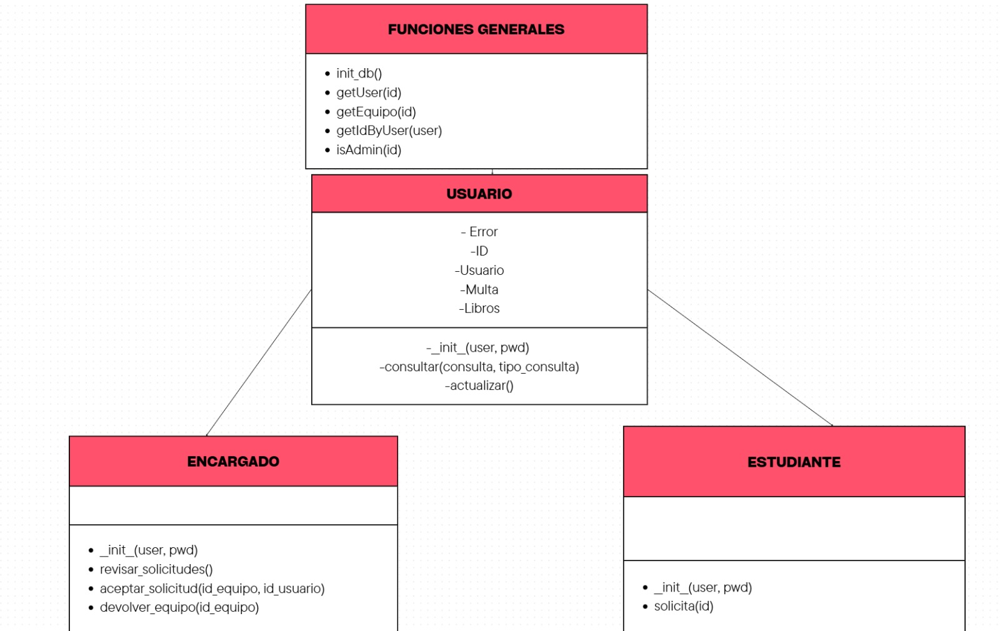

# Sistema gestion de inventario (lab de Electronica)
en este trabajo realizamos en Python un sistema para el laboratorio de Electronica

El desarrollo de este código fue un proceso que requirió comprender cómo funcionaban las diferentes partes del programa y cómo se conectaban con el módulo proc, encargado de manejar estudiantes, encargados, equipos y solicitudes.

Primero, se implementó la parte del estudiante, donde se inicia sesión con un usuario y contraseña, se verifican posibles errores y se comprueba si tiene permisos de administrador.

Después, se desarrollaron las consultas de equipos y la creación de solicitudes. El estudiante puede buscar un equipo, como un amplificador, y solicitarlo mediante su id. Se utilizaron condiciones if para manejar los diferentes resultados, como una solicitud exitosa, un equipo no disponible o una solicitud previa.

Luego, se implementó la parte del encargado, que permite consultar equipos, revisar y aceptar solicitudes, y registrar devoluciones. En esta sección fue importante respetar el orden de las acciones, ya que primero se debe aceptar una solicitud para después registrar la devolución.

Finalmente, se utiliza proc.init_db() para iniciar la base de datos y se pregunta al usuario si desea ingresar como estudiante o encargado, ejecutando la función correspondiente.

Una de las principales dificultades fue comprender la comunicación con el módulo proc, ya que funciones como consultar(), solicitar(), revisar_solicitudes() y aceptar_solicitud() están definidas allí. Este proceso permitió reforzar conocimientos sobre clases, funciones, variables y condicionales, además de aprender a dividir un programa en partes pequeñas para facilitar su comprensión.
## Uso del codigo 
### 1. EJECUTAR 
```
python main.py
```
Se requieren el archivo data.db para que el programa funcione.

### 2. USUARIOS Y CONTRASEÑAS 

Usuarios y contraseñas que se pueden usar para iniciar sesión

| Usuario | Contraseña | 
| --- | --- | 
|  admin  |  contrasena123 | 
|  usuario1 |  contrasena123 |
|  jaime777 |  elunicoconcontraseñasegura!123!123 |

### 3. EQUIPOS

Equipo que se puede consultar y solicitar

| Nombre | Descripcion |
| --- | --- | 
|  Amplificador LM386  | Amplificadores |
| Alcohol isopropilico | Limpieza |
|  Calculadora Progamable texas | Calculadoras |
|  Resistencia 1 ohm | Electronica |
|  Cable HDMI | Cables |

## UML


## Miembros

- Nicolas Luengas
- Jonathan Archila
- Andrés Casallas
- Alejandro campuzano
